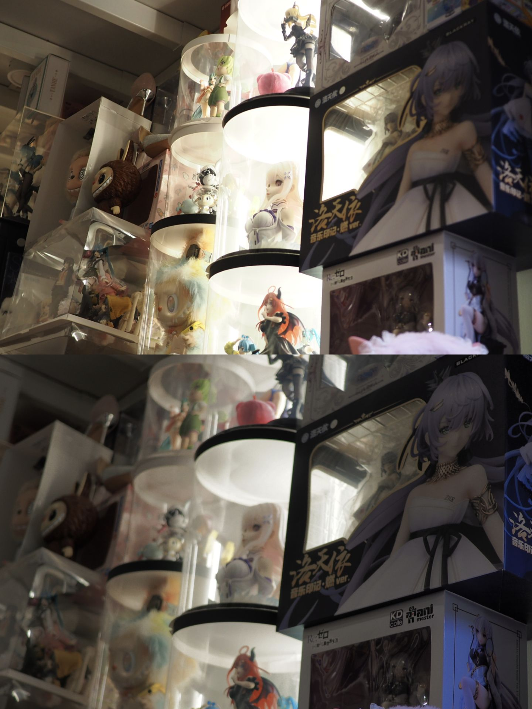

# Olympus E-P7 HSL / 奥林巴斯 E-P7 直出增强固件

[中文](#中文) · [English](#english) · [下载 / Releases](https://github.com/JDui/oly_fw_analysis_ep7/releases)

## 中文

### 项目特点

EP7HSL 基于奥林巴斯 E-P7 原厂 1.1（build 1100）固件，以最低限度的改动提升机内 JPEG 直出。HSL 色轮、高光压制和 Rec 多帧合成都沿用原有的操作入口。普通快门仍可半按对焦、全按单拍。

**固件已经在实际 E-P7 机身上经过功能验证和稳定性测试，在已测试的场景中运行稳定。** Rec 四帧合成已在 030 上实拍成功。最新 032 对 Rec 沿用现有焦点的修正已通过定向离线回放，具体实机覆盖见各版记录。[030 实机记录](docs/ep7/EXPERIMENTAL_SD_030.md) · [032 验证记录](docs/ep7/EXPERIMENTAL_SD_032.md)

### 效果对比

**上方是奥林巴斯原厂固件直出，下方是 EP7HSL 直出。** 看下图的灯罩和受光区域，下方保留了更多亮部过渡，暗处的人偶和包装也能看见细节。

### 功能介绍

| 功能 | 用途 |
| --- | --- |
| **HSL 色轮转盘** | 在原厂 COLOR 色轮内分别调整各色区的色相、饱和度和明度，四组 COLOR 预设分别保存。 |
| **HDR200 / HDR400 高光增强** | 用单张 JPEG 的曲线压住高光，保留仍有信息的亮部纹理和渐变。200 较温和，400 更强。 |
| **Rec 四帧合成** | 按一次 Rec 拍摄并合成四帧，使用类似手机多帧 HDR 的工作方式，直接保存合成 JPEG。支持静音电子快门。 |

### 使用说明

#### SD 卡刷入

**仅限奥林巴斯 E-P7 原厂 1.1。** PEN-F、OM PEN、OM-3 和其他机型均不兼容。目前只有 E-P7 可供开发和验证。刷机有风险，可能造成黑屏、重启或相机无法使用。原厂返回文件需要机身更新入口仍可用。欢迎小范围使用，请勿大规模推广。

1. 下载并解压 `EP7HSL-032-EXPERIMENTAL-SD.zip`，准备电量充足的电池。直接使用 SD 卡刷入即可，拍摄档位和图像模式保持当前设置。[下载页](https://github.com/JDui/oly_fw_analysis_ep7/releases/tag/ep7hsl-032)
2. 将 `install` 内的 `DCOLYMP` 文件夹复制到 SD 卡根目录，得到 `SD:/DCOLYMP/E1429999.BIN`。
3. 相机关机后插卡，**按住 OK 开机**，指示灯开始后松开 OK。更新过程中保持供电和卡就位。
4. AF 指示灯由常亮转为快速闪烁后关机，取出更新卡，再正常开机。首次使用 Rec 前，机身固件版本显示 **1.1v032**。
5. 如需恢复原厂 1.1，改用 `restore-stock` 内的 `DCOLYMP`，按同样步骤刷入。每次更新卡上只放一套 `DCOLYMP`。

#### HSL 色轮

将色彩控制拨杆切到 **COLOR**，进入原厂色轮页面。**每按一次删除键（垃圾桶键），按 S 饱和度 → L 明度 → H 色相 → S 的顺序切换色轮。** 前拨轮选色区，后拨轮调整数值，INFO 在单色区与 ALL 之间切换。H/L 范围为 −5 至 +5。短按 OK 退出，长按 OK 复位当前轴。

#### DR200 / DR400 高光压制

1. 进入 **COLOR 1–4** 中任一预设，使用原厂曲线拨盘进入高光／阴影页。
2. 从高光／阴影页按两次 **INFO**，经过中间调页进入 **HDR** 页。再按一次回到高光／阴影页。
3. 转动任一拨轮选择 **OFF**、**HDR200** 或 **HDR400**。短按 OK 退出，长按 OK 回到 OFF。
4. 半按快门观察取景，拍摄 JPEG 查看亮部细节。可固定构图和曝光分别拍三档对照。

#### Rec 按钮多帧合成

1. 在 **P / A / S / M** 任一拍摄档，将 **按钮功能 → Rec（◎功能）** 分配给菜单里现有的 **HDR** 选项。这个选项用来启动新加入的四帧合成。
2. 选择机械单张、防震单张或**静音电子单张（♥）**。如需静音多帧拍摄，选择静音电子单张即可。
3. 回到取景，用实体快门半按对焦。可以保持半按，按一次 **Rec** 启动四帧合成。直接按 Rec 时，032 设计为沿用镜头当前焦点。
4. 持稳相机，等相机完成合成和写卡，再到回放查看合成 JPEG。用普通快门全按可以继续拍普通单张。

### 致谢

感谢 fishcu 的固件逆向研究、工具和 PEN-F HSL 实现，也感谢参与 E-P7 实机试拍和稳定性测试的用户。[上游项目](https://github.com/fishcu/oly_fw_analysis) · [E-P7 研究文档](docs/ep7/README.md) · [权利与来源](RIGHTS-AND-PROVENANCE.md)

## English

### Project features

EP7HSL builds on stock Olympus E-P7 firmware 1.1 (build 1100). It improves straight-out-of-camera JPEGs with minimal changes to the original controls and workflow. Half-pressing the shutter still focuses, and fully pressing it still takes a single shot.

**The firmware has undergone functional and stability testing on a physical E-P7 and ran reliably in the scenarios tested.** Rec four-frame capture was demonstrated on camera with 030. The 032 change to reuse the current focus passed targeted offline replay. [030 camera results](docs/ep7/EXPERIMENTAL_SD_030.md) · [032 validation record](docs/ep7/EXPERIMENTAL_SD_032.md)

### Image comparison

**Stock Olympus firmware is shown above and EP7HSL below.** The lower image shows more gradation in the lit areas while keeping details visible in the darker figures and packaging. [View the comparison](#效果对比)

### Features

| Feature | What it does |
| --- | --- |
| **HSL color wheels** | Adjust hue, saturation, and lightness per color sector in the stock COLOR editor. The four COLOR profiles store their settings separately. |
| **HDR200 / HDR400 highlight enhancement** | Compress highlights in a single JPEG to retain texture and gradation where detail remains. 200 is gentler and 400 is stronger. |
| **Rec four-frame capture** | One press captures and merges four frames into a JPEG, with a workflow similar to smartphone multi-frame HDR. Supports silent electronic shutter. |

### How to use

#### Install from SD card

**Olympus E-P7 with stock firmware 1.1 only.** PEN-F, OM PEN, OM-3, and other models are incompatible. The E-P7 is the only body available for development and testing. Flashing can cause a black screen, reboot loops, or an unusable camera. Stock restoration requires a working update path. Please keep use within a small circle.

1. Download and extract `EP7HSL-032-EXPERIMENTAL-SD.zip` and use a sufficiently charged battery. Install directly from SD with your current shooting and picture settings. [Download](https://github.com/JDui/oly_fw_analysis_ep7/releases/tag/ep7hsl-032)
2. Copy `DCOLYMP` from inside `install` to the SD card root, yielding `SD:/DCOLYMP/E1429999.BIN`.
3. Insert the card with the camera off. **Hold OK while powering on** and release it when the indicator starts. Keep the camera powered and the card inserted during the update.
4. When the AF indicator changes from steady illumination to rapid flashing, power off, remove the update card, and power on normally. The body initially displays **1.1v032** before Rec is used.
5. To restore stock 1.1, use `DCOLYMP` from `restore-stock` and repeat the same update procedure. Keep one update folder on the card at a time.

#### HSL wheels

Set the front lever to **COLOR** and open the stock color wheel. **Each press of Delete cycles S (Saturation) → L (Lightness) → H (Hue) → S.** Use the front dial to select a sector and the rear dial to adjust it. INFO switches between one sector and ALL. H/L ranges from −5 to +5. Press OK briefly to exit or hold OK to reset the active axis.

#### DR200 / DR400 highlight compression

1. Select any **COLOR 1–4** profile and open the stock Highlight & Shadow curve page.
2. Press **INFO** twice to pass Midtone and reach the **HDR** page. The next press returns to Highlight & Shadow.
3. Turn either dial to choose **OFF**, **HDR200**, or **HDR400**. Press OK briefly to exit or hold OK to reset to OFF.
4. Half-press the shutter to check live view, then take a JPEG to inspect the highlights. Compare all three levels with the same framing and exposure.

#### Multi-frame capture with Rec

1. In **P / A / S / M**, go to **Button Function → Rec** and assign the existing **HDR** option. That assignment starts the new four-frame capture.
2. Select mechanical single, anti-shock single, or **silent electronic single (♥)** drive. Select silent electronic single for silent multi-frame capture.
3. In live view, half-press the physical shutter to focus. You can hold the half-press and press **Rec** once to start the merge. A direct Rec press in 032 is designed to use the lens's current focus.
4. Keep the camera steady until merging and card writing finish, then review the merged JPEG. A full press of the regular shutter still takes a single shot.

### Acknowledgments

Thanks to fishcu for the firmware research, tools, and PEN-F HSL reference, and to the users who tested shooting and stability on the E-P7. [Upstream project](https://github.com/fishcu/oly_fw_analysis) · [E-P7 research](docs/ep7/README.md) · [Rights and provenance](RIGHTS-AND-PROVENANCE.md)
